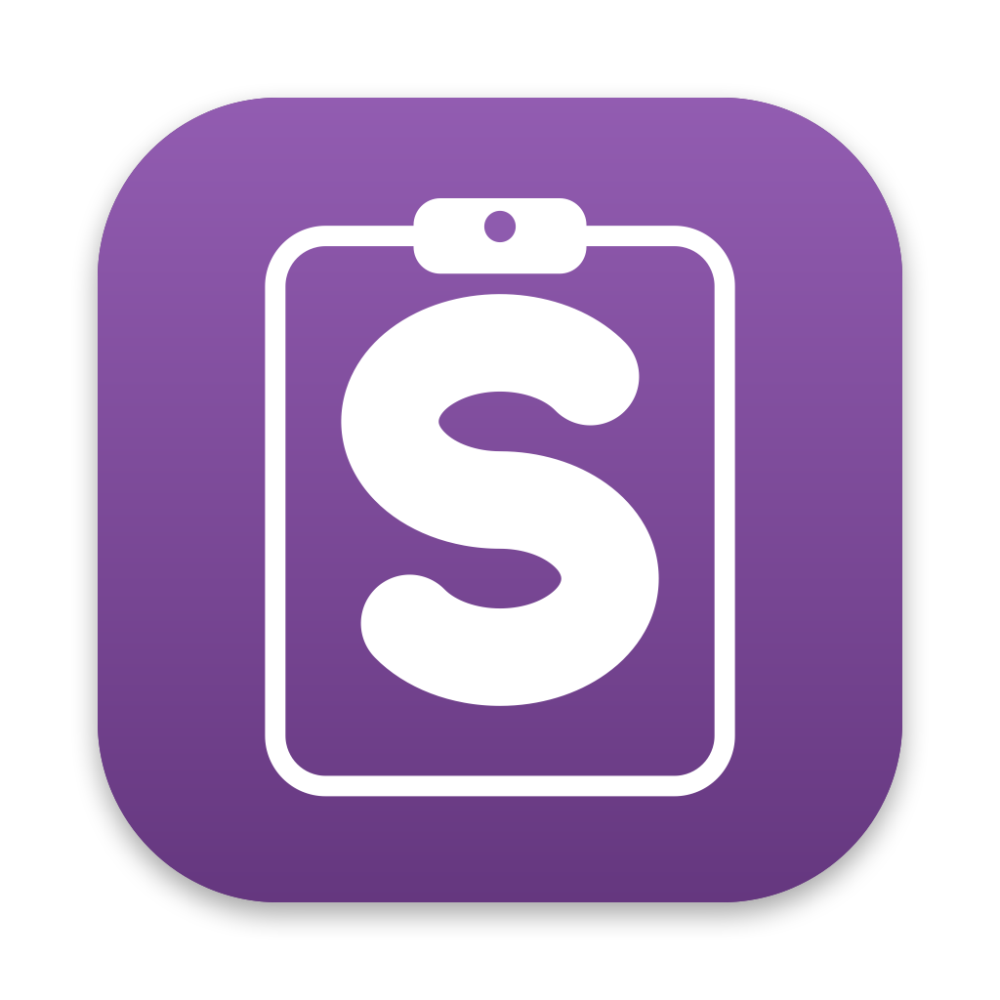

# sPaste

A keyboard-first clipboard history for macOS, in the spirit of Ditto on Windows, Maccy on macOS and Parcellite on Linux, with vim keys and filters by type and time.

## Why another clipboard manager

Maccy is very good, and sPaste borrows its idea: a small panel on a hotkey, nothing else. Two things are missing there for a keyboard user:

- A normal mode. In sPaste the panel opens with `j` and `k` moving the selection, counts (`5j`), `gg` and `G`, `/` searching from the newest item, `?` from the oldest, and `n` and `N` repeating the search. In Maccy every key types into the search field.
- Filters by type and time. `fi` shows only images, `ff` only files, `ft` only text, and `:since 2h` or `:until yesterday` narrow the list by time.

The history is a plain folder: one file per item and a text index, so pruning or deleting an item removes its file and nothing stays readable on disk.

## Part of uSuite

sPaste is a utility of the [uSuite](https://github.com/uSuite) organization, built to the same rules as the sSuite tools: one job, plain text config, keyboard first, Swift and Apple frameworks only, nothing uploaded. It shares the keymap grammar and config code of [scommon](https://github.com/uSuite/scommon).

## Use

Shift+Cmd+C opens and closes the panel (`hotkey` in the config). Enter copies the selected item back to the clipboard and closes the panel; press Cmd+V where you want it. `paste_on_enter yes` pastes for you, which needs Accessibility access. The full key list is in `docs/keys.md`.

Settings are in `~/.config/spaste/config` and keys in `~/.config/spaste/keymap`, both plain `key value` text written with comments on first run. The history lives in `~/Library/Application Support/sPaste/history/`, readable only by you.

Passwords copied from a password manager are not stored: items marked concealed or transient on the pasteboard are skipped, and `ignore_app` skips any app you name.

## Build

`make test`, `make app`, `make run`. Swift 6.2 and macOS 26 or newer. MIT licence.
